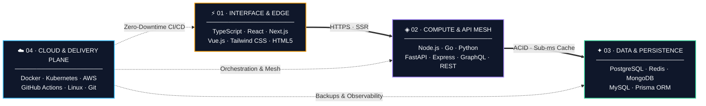

<a id="top"></a>

<!-- ═══════════════════════════════════════════════════════════════════════════ -->
<!-- 00 // LUXURY WAVE HERO & DYNAMIC IDENTITY                                  -->
<!-- ═══════════════════════════════════════════════════════════════════════════ -->

<div align="center">

<picture>
  <source media="(prefers-color-scheme: dark)" srcset="https://capsule-render.vercel.app/api?type=waving&color=0:090D16,42:1E1B4B,78:78350F,100:F59E0B&height=235&section=header&text=SMIT%20MANDALIYA&fontSize=56&fontColor=F8FAFC&fontAlignY=38&desc=GEAR-FIFTH%20%E2%97%86%20SENIOR%20FULL-STACK%20%26%20SYSTEMS%20ARCHITECT&descSize=16&descAlignY=60&descColor=FDE68A&animation=fadeIn" />
  <source media="(prefers-color-scheme: light)" srcset="https://capsule-render.vercel.app/api?type=waving&color=0:0F172A,45:312E81,80:B45309,100:F59E0B&height=235&section=header&text=SMIT%20MANDALIYA&fontSize=56&fontColor=FFFFFF&fontAlignY=38&desc=GEAR-FIFTH%20%E2%97%86%20SENIOR%20FULL-STACK%20%26%20SYSTEMS%20ARCHITECT&descSize=16&descAlignY=60&descColor=FEF3C7&animation=fadeIn" />
  
</picture>

<picture>
  <source media="(prefers-color-scheme: dark)" srcset="https://readme-typing-svg.demolab.com?font=Fira+Code&weight=600&size=18&duration=3000&pause=1000&color=FBBF24&center=true&vcenter=true&width=720&height=36&lines=Architecting+Fault-Tolerant+Distributed+Systems+%E2%9A%A1;Crafting+High-Velocity+Full-Stack+Experiences+%E2%9C%A6;Zero-Downtime+Cloud+Platforms+%26+API+Meshes+%E2%97%88;Gear+5th+Awakened+%E2%80%94+Drums+of+Liberation+Active+%F0%9F%A5%81" />
  <source media="(prefers-color-scheme: light)" srcset="https://readme-typing-svg.demolab.com?font=Fira+Code&weight=600&size=18&duration=3000&pause=1000&color=B45309&center=true&vcenter=true&width=720&height=36&lines=Architecting+Fault-Tolerant+Distributed+Systems+%E2%9A%A1;Crafting+High-Velocity+Full-Stack+Experiences+%E2%9C%A6;Zero-Downtime+Cloud+Platforms+%26+API+Meshes+%E2%97%88;Gear+5th+Awakened+%E2%80%94+Drums+of+Liberation+Active+%F0%9F%A5%81" />
  
</picture>

<br />

<!-- Primary Action Strip -->
<p align="center">
  <a href="https://github.com/gear-fifth">
    
  </a>
  &nbsp;
  <a href="https://linkedin.com/in/">
    
  </a>
  &nbsp;
  <a href="mailto:smit.mandaliya@cardinalgroup.com">
    
  </a>
  &nbsp;
  <a href="https://github.com/gear-fifth">
    
  </a>
</p>

<!-- Status Pills -->
<p align="center">
  
  &nbsp;
  
  &nbsp;
  
</p>

<br />

> ### *“Peak performance, total flexibility, and unlimited creativity.”*
> <sub>— **The Warrior of Liberation Philosophy** · Engineering without artificial ceilings</sub>

</div>

<br />


<br />

<!-- ═══════════════════════════════════════════════════════════════════════════ -->
<!-- 01 // EXECUTIVE DOSSIER & RUNTIME IDENTITY                                 -->
<!-- ═══════════════════════════════════════════════════════════════════════════ -->

<h2 align="center"><code>01</code> &nbsp;✦&nbsp; ARCHITECTURAL PROFILE &amp; RUNTIME</h2>

<table>
  <tr>
    <td width="52%" valign="top">
      <br />
      <p>
        I craft <strong>bulletproof distributed backends</strong>, high-throughput API meshes, and <strong>razor-sharp web interfaces</strong>. Every line of code is built to feel effortless to users and resilient under real-world production load.
      </p>
      <br />
      <p><strong>✦ Core Engineering Pillars</strong></p>
      <ul>
        <li><strong>Resilience by Design</strong> — Idempotent APIs, fault isolation &amp; zero-downtime rollouts.</li>
        <li><strong>Mechanical Sympathy</strong> — Lean schemas, sub-millisecond caching &amp; tuned queries.</li>
        <li><strong>Design-System Craft</strong> — Accessible, fluid UIs powered by strict TypeScript.</li>
        <li><strong>Cloud-Native Velocity</strong> — Automated CI/CD, container parity &amp; live observability.</li>
      </ul>
      <br />
      <p>
        <sub>🤝 <em>Open to collaborating on ambitious open-source tools, microservice platforms, developer infrastructure, and high-growth startup architectures.</em></sub>
      </p>
    </td>
    <td width="48%" valign="top">

```ts
// gear-fifth.config.ts // Sun God Nika Protocol

export const architect = {
  name:       "Smit Mandaliya",
  alias:      "@gear-fifth",
  role:       "Senior Full-Stack & Systems Architect",
  status:     "AWAKENED // Gear 5th",
  devilFruit: "Hito Hito no Mi, Model: Nika",
  passive:    "Drums of Liberation",
  bounty:     "฿ 3,000,000,000 Clean Commits",

  focus: [
    "High-Concurrency Distributed Systems",
    "Event-Driven & Microservice Architecture",
    "Cloud-Native Observability & DevOps",
    "Precision Frontend Design Systems",
  ],
} as const;
```

  </td>
  </tr>
</table>

<br />


<br />

<!-- ═══════════════════════════════════════════════════════════════════════════ -->
<!-- 02 // SYSTEM ARCHITECTURE BLUEPRINT & TECH DECK                            -->
<!-- ═══════════════════════════════════════════════════════════════════════════ -->

<h2 align="center"><code>02</code> &nbsp;◈&nbsp; SYSTEM ARCHITECTURE &amp; TECH DECK</h2>

<p align="center">
  <sub><em>End-to-end production topology — from sub-100ms edge experiences to distributed state and automated cloud delivery.</em></sub>
</p>



<br />

<p align="center">
  <picture>
    <source media="(prefers-color-scheme: dark)" srcset="https://skillicons.dev/icons?i=ts,js,react,nextjs,vue,tailwind,nodejs,go,py,fastapi,express,graphql&perline=12&theme=dark" />
    <source media="(prefers-color-scheme: light)" srcset="https://skillicons.dev/icons?i=ts,js,react,nextjs,vue,tailwind,nodejs,go,py,fastapi,express,graphql&perline=12&theme=light" />
    
  </picture>
  <br />
  <picture>
    <source media="(prefers-color-scheme: dark)" srcset="https://skillicons.dev/icons?i=postgres,redis,mongodb,mysql,prisma,docker,kubernetes,aws,githubactions,linux,git,postman&perline=12&theme=dark" />
    <source media="(prefers-color-scheme: light)" srcset="https://skillicons.dev/icons?i=postgres,redis,mongodb,mysql,prisma,docker,kubernetes,aws,githubactions,linux,git,postman&perline=12&theme=light" />
    
  </picture>
</p>

<br />

<!-- 4-Column Architectural Bento Matrix -->
<table width="100%">
  <tr>
    <td width="25%" valign="top" align="center">
      <br />
      <strong>⚡ INTERFACE</strong>
      <br />
      <sub><code>EDGE &amp; UI</code></sub>
      <br /><br />
      <sub>
        TypeScript · JavaScript<br />
        React · Next.js · Vue.js<br />
        Tailwind · HTML5 · CSS3
      </sub>
      <br /><br />
      <sub><em>Sub-100ms interactions &amp; modular design systems</em></sub>
      <br /><br />
    </td>
    <td width="25%" valign="top" align="center">
      <br />
      <strong>◈ COMPUTE</strong>
      <br />
      <sub><code>APIs &amp; CORE</code></sub>
      <br /><br />
      <sub>
        Node.js · Go · Python<br />
        FastAPI · Express.js<br />
        GraphQL · REST APIs
      </sub>
      <br /><br />
      <sub><em>High-concurrency services &amp; event pipelines</em></sub>
      <br /><br />
    </td>
    <td width="25%" valign="top" align="center">
      <br />
      <strong>✦ PERSISTENCE</strong>
      <br />
      <sub><code>DATA &amp; CACHE</code></sub>
      <br /><br />
      <sub>
        PostgreSQL · MySQL<br />
        MongoDB · Redis<br />
        Prisma ORM
      </sub>
      <br /><br />
      <sub><em>ACID integrity &amp; in-memory acceleration</em></sub>
      <br /><br />
    </td>
    <td width="25%" valign="top" align="center">
      <br />
      <strong>☁️ DELIVERY</strong>
      <br />
      <sub><code>CLOUD &amp; DEVOPS</code></sub>
      <br /><br />
      <sub>
        Docker · Kubernetes<br />
        AWS · GitHub Actions<br />
        Linux · Git · Postman
      </sub>
      <br /><br />
      <sub><em>Zero-downtime CI/CD &amp; cloud observability</em></sub>
      <br /><br />
    </td>
  </tr>
</table>

<br />


<br />

<!-- ═══════════════════════════════════════════════════════════════════════════ -->
<!-- 03 // ACTIVE MISSIONS & BENTO ROADMAP                                      -->
<!-- ═══════════════════════════════════════════════════════════════════════════ -->

<h2 align="center"><code>03</code> &nbsp;⟡&nbsp; ACTIVE DIRECTIVES &amp; QUEST BOARD</h2>

<table width="100%">
  <tr>
    <td width="50%" valign="top">
      <p><strong>🚢 <code>RFC-01</code> · Resilient Full-Stack Systems</strong> &nbsp; <code>ACTIVE</code></p>
      <p><sub>Designing fault-tolerant, multi-tier production applications engineered for scale, clean domain boundaries, and crisp developer ergonomics.</sub></p>
    </td>
    <td width="50%" valign="top">
      <p><strong>⚡ <code>RFC-02</code> · Open-Source Dev Tools &amp; CLIs</strong> &nbsp; <code>SHIPPING</code></p>
      <p><sub>Building fast, focused open-source utilities and terminal workflows that eliminate engineering friction for modern teams.</sub></p>
    </td>
  </tr>
  <tr>
    <td width="50%" valign="top">
      <p><strong>⚔️ <code>RFC-03</code> · Zero-Downtime Cloud Pipelines</strong> &nbsp; <code>SCALING</code></p>
      <p><sub>Refining containerized CI/CD delivery, Kubernetes orchestration, and cloud-native observability across distributed environments.</sub></p>
    </td>
    <td width="50%" valign="top">
      <p><strong>🥁 <code>RFC-04</code> · Drums of Liberation Discipline</strong> &nbsp; <code>CONTINUOUS</code></p>
      <p><sub>Maintaining relentless commit quality, architectural curiosity, and joyful craftsmanship on every single release.</sub></p>
    </td>
  </tr>
</table>

<details>
<summary><sub><code>gear-fifth@sun-god-nika:~$ cat active_quests.json</code> &nbsp;— inspect live terminal manifest</sub></summary>

```json
{
  "protocol": "sun-god-nika.v5",
  "status": "AWAKENED",
  "quests": {
    "quest_01": "🚢 Architect high-resilience full-stack solutions",
    "quest_02": "⚡ Ship open-source developer utilities & CLI tools",
    "quest_03": "⚔️ Optimize zero-downtime CI/CD deployment pipelines",
    "quest_04": "🥁 Keep the Drums of Liberation beating with 100% commit discipline"
  }
}
```

</details>

<br />


<br />

<!-- ═══════════════════════════════════════════════════════════════════════════ -->
<!-- 04 // ENGINEERING TELEMETRY & LIVE VELOCITY                                -->
<!-- ═══════════════════════════════════════════════════════════════════════════ -->

<h2 align="center"><code>04</code> &nbsp;✦&nbsp; ENGINEERING TELEMETRY &amp; VELOCITY</h2>

<p align="center">
  <a href="https://github.com/gear-fifth">
    <picture>
      <source media="(prefers-color-scheme: dark)" srcset="https://github-stats-extended.vercel.app/api?username=gear-fifth&show_icons=true&bg_color=090d16&border_color=1e293b&border_radius=12&title_color=f59e0b&icon_color=a78bfa&text_color=e2e8f0&card_width=430" />
      <source media="(prefers-color-scheme: light)" srcset="https://github-stats-extended.vercel.app/api?username=gear-fifth&show_icons=true&bg_color=ffffff&border_color=cbd5e1&border_radius=12&title_color=b45309&icon_color=7c3aed&text_color=0f172a&card_width=430" />
      
    </picture>
  </a>
  &nbsp;
  <a href="https://github.com/gear-fifth">
    <picture>
      <source media="(prefers-color-scheme: dark)" srcset="https://streak-stats.demolab.com/?user=gear-fifth&background=090d16&border=1e293b&border_radius=12&ring=f59e0b&fire=f59e0b&currStreakLabel=f59e0b&currStreakNum=f8fafc&sideNums=f8fafc&sideLabels=94a3b8&dates=64748b&stroke=1e293b&card_width=430" />
      <source media="(prefers-color-scheme: light)" srcset="https://streak-stats.demolab.com/?user=gear-fifth&background=ffffff&border=cbd5e1&border_radius=12&ring=d97706&fire=d97706&currStreakLabel=b45309&currStreakNum=0f172a&sideNums=0f172a&sideLabels=475569&dates=64748b&stroke=e2e8f0&card_width=430" />
      
    </picture>
  </a>
</p>

<p align="center">
  <a href="https://github.com/gear-fifth">
    <picture>
      <source media="(prefers-color-scheme: dark)" srcset="https://github-stats-extended.vercel.app/api/top-langs/?username=gear-fifth&layout=compact&bg_color=090d16&border_color=1e293b&border_radius=12&title_color=f59e0b&text_color=e2e8f0&card_width=430" />
      <source media="(prefers-color-scheme: light)" srcset="https://github-stats-extended.vercel.app/api/top-langs/?username=gear-fifth&layout=compact&bg_color=ffffff&border_color=cbd5e1&border_radius=12&title_color=b45309&text_color=0f172a&card_width=430" />
      
    </picture>
  </a>
</p>

<p align="center">
  <a href="https://github.com/gear-fifth">
    <picture>
      <source media="(prefers-color-scheme: dark)" srcset="https://github-readme-activity-graph.vercel.app/graph?username=gear-fifth&bg_color=090d16&color=e2e8f0&line=f59e0b&point=a78bfa&area=true&area_color=f59e0b&hide_border=false&custom_title=Drums%20of%20Liberation%20%E2%80%94%20Contribution%20Velocity" />
      <source media="(prefers-color-scheme: light)" srcset="https://github-readme-activity-graph.vercel.app/graph?username=gear-fifth&bg_color=ffffff&color=0f172a&line=d97706&point=7c3aed&area=true&area_color=f59e0b&hide_border=false&custom_title=Drums%20of%20Liberation%20%E2%80%94%20Contribution%20Velocity" />
      
    </picture>
  </a>
</p>

<br />

<!-- ═══════════════════════════════════════════════════════════════════════════ -->
<!-- 05 // CONTRIBUTION PULSE — JOLLY ROGER ARCADE                              -->
<!-- ═══════════════════════════════════════════════════════════════════════════ -->

<h2 align="center"><code>05</code> &nbsp;🐍&nbsp; CONTRIBUTION PULSE</h2>

<p align="center">
  <sub><em>“Even in battle, the Joy Boy plays.” — Live GitHub Contribution Grid Animation</em></sub>
</p>

<p align="center">
  <picture>
    <source media="(prefers-color-scheme: dark)" srcset="https://raw.githubusercontent.com/gear-fifth/gear-fifth/output/snake-dark.svg" />
    <source media="(prefers-color-scheme: light)" srcset="https://raw.githubusercontent.com/gear-fifth/gear-fifth/output/snake-light.svg" />
    
  </picture>
</p>

<br />

<!-- ═══════════════════════════════════════════════════════════════════════════ -->
<!-- 06 // CLOSING SIGNATURE WAVE                                               -->
<!-- ═══════════════════════════════════════════════════════════════════════════ -->

<div align="center">

### *“If you don’t take risks, you can’t create a future.”*
<sub>— **Monkey D. Luffy (Joy Boy)**</sub>

<br />

<a href="#top">
  
</a>

<br /><br />


</div>
